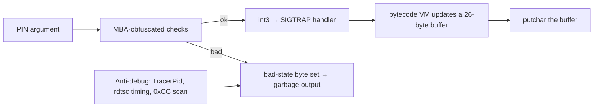

<div align="center">
# ❄️ pocketflag — Writeup
 


 
 

</div>
> *A mystery binary that gives almost random output for any input. All we know: it wants a 4-digit PIN.*
 
**Flag format:** `cruXipher{...}`
 
---
 
## TL;DR
 
The binary checks the PIN with obfuscated (MBA-style) arithmetic, then runs a tiny VM driven by `int3` traps and a `SIGTRAP` handler. Wrong PIN, or any debugger, silently corrupts the output. Solving four equations gives the PIN, and running the binary normally prints the flag.
 
| Item | Value |
|------|-------|
| PIN  | `6742` |
| Flag | `cruXipher{0bfusc4t1on_g0D}` |
 
---
 
## 1. Recon
 
```bash
file pocketflag
# ELF 64-bit LSB executable, x86-64, dynamically linked, stripped
strings -n 6 pocketflag
```
 
Only a handful of libc imports: `sigaction`, `syscall`, `memset`, `strlen`, `putchar`. No readable strings, so everything meaningful is computed at runtime.
 
> The ELF interpreter points to a Nix store path that does not exist on most machines. Run it through the system loader instead:
> ```bash
> /lib64/ld-linux-x86-64.so.2 ./pocketflag 6742
> ```
 
## 2. How it works
 

 
- **Constructor** reads `/proc/self/status` (path string XOR-encrypted with `0x5a`) to detect `TracerPid`.
- **`sigaction`** installs a handler for `SIGTRAP`. Each `int3` makes the handler read an opcode and operand from the bytes right after the trap, and update a 26-byte buffer.
- The handler also uses **`rdtsc` timing** and a **breakpoint-byte check**. If anything looks off, a "bad state" byte is set and the output is scrambled silently, which is why it "seems random".
- The final buffer is printed with `putchar`.
## 3. Recovering the PIN
 
The MBA expressions simplify with standard identities:
 
| Obfuscated form | Simplifies to |
|-----------------|---------------|
| `(a\|b) - (a&b)` | `a ^ b` |
| `(a^b) + 2*(a&b)` | `a + b` |
 
With the digits `d0 d1 d2 d3` (ASCII), the checks reduce to:
 
```text
d0 + d3 = 0x68
d1 ^ d2 = 0x03
d0 ^ d1 = 0x01
d2      = 0x34   ('4')
```
 
Solving:
 
```text
d2 = 0x34 → '4'
d1 = 0x34 ^ 0x03 = 0x37 → '7'
d0 = 0x37 ^ 0x01 = 0x36 → '6'
d3 = 0x68 - 0x36 = 0x32 → '2'
```
 
**PIN = `6742`**
 
## 4. Getting the flag
 
Do **not** attach a debugger (the anti-debug would corrupt the output). Just run it:
 
```bash
/lib64/ld-linux-x86-64.so.2 ./pocketflag 6742
```
 
```text
cruXipher{0bfusc4t1on_g0D}
```
 
Ran it three times: same output each time.
 
---
 <div align="center">
# 🌱 Give me your seed — Writeup
 


 


 
</div>
> *Your friend finds a YouTube video with a Minecraft world and wants the seed. All he knows is that it's between 100k and 150k. The attached zip contains images of the seed.*
 
**Flag format:** `cruXipher{seed}`
 
---
 
## TL;DR
 
The five screenshots are Minecraft 1.21.3 **F3 debug screens**. They leak exact coordinates, the biome under the player and several structures. With the seed bounded to 100k–150k, every seed can be tested with cubiomes. Only one reproduces all the biomes.
 
| Item | Value |
|------|-------|
| Seed | `123321` |
| Flag | `cruXipher{123321}` |
 
---
 
## 1. Recon
 
```bash
unzip images.zip
# image.png  image2.png  image3.png  image4.png  image5.png
```
 
The tags `compression` and `custom-format` are a red herring: ZIP headers, PNG chunks, bit planes and `strings` contain nothing. All the data is the F3 text visible in the pixels. Every screenshot shows `Minecraft 1.21.3 (1.21.3/vanilla)`, so the generator version is known.
 
## 2. Data from the screenshots
 
| Image | XYZ | Biome | What is visible |
|-------|-----|-------|-----------------|
| `image.png`  | -485, 153, -52   | `dark_forest` | forest overview |
| `image2.png` | 2922, 110, -4678 | `dark_forest` | woodland mansion roof |
| `image3.png` | -1959, 34, 36    | `desert`      | stronghold portal room |
| `image4.png` | -1916, 69, 81    | `desert`      | desert pyramid |
| `image5.png` | -4372, 77, 31    | `jungle`      | jungle temple |
 

 
## 3. Solver
 
`brute.c`:
 
```c
#include "cubiomes/generator.h"
#include "cubiomes/finders.h"
#include <stdio.h>
 
int main(int argc, char **argv) {
    uint64_t lo = atoll(argv[1]), hi = atoll(argv[2]);
    Generator g;
    setupGenerator(&g, MC_1_21_3, 0);
 
    struct { int x, y, z, b; } pts[] = {
        {  -485, 153,  -52, dark_forest },
        {  2922, 110, -4678, dark_forest },
        { -1959,  34,   36, desert      },
        { -1916,  69,   81, desert      },
        { -4372,  77,   31, jungle      },
    };
 
    for (uint64_t s = lo; s <= hi; s++) {
        applySeed(&g, DIM_OVERWORLD, s);
        int ok = 0;
        for (int i = 0; i < 5; i++)
            if (getBiomeAt(&g, 1, pts[i].x, pts[i].y, pts[i].z) == pts[i].b) ok++;
        if (ok >= 4) printf("seed %llu match %d/5\n", (unsigned long long)s, ok);
    }
}
```
 
```bash
git clone https://github.com/Cubitect/cubiomes.git
gcc -O3 -o brute brute.c $(ls cubiomes/*.c | grep -v tests.c) -Icubiomes -lm
./brute 100000 150000
```
 
> `tests.c` is excluded because it defines its own `main`.
 
```text
seed 105983 match 4/5
seed 123321 match 5/5
```
 
Runtime is about 4 seconds, and **123321** is the only seed matching all five points.
 
## 4. Verification
 
Generating structures for seed `123321` and comparing with the screenshots:
 
| Structure | Generated | Screenshot |
|-----------|-----------|------------|
| Desert pyramid   | (-1920, 80)   | (-1915, 81) |
| Jungle temple    | (-4368, 32)   | (-4371, 31) |
| Stronghold #0    | (-1964, 4)    | portal room at (-1958, 36) |
| Woodland mansion | (2912, -4624) | roof at (2922, -4677) |
 
All four line up. When checking the mansion, remember its regions are 80 chunks wide, not 32.
 
---
 
## 🏁 Flag
 
```text
cruXipher{123321}
```
 

 
