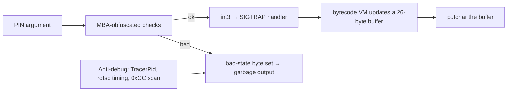

<div align="center">
# ❄️ pocketflag — Writeup
 


 
 

</div>
> *A mystery binary that gives almost random output for any input. All we know: it wants a 4-digit PIN.*
 
**Flag format:** `cruXipher{...}`
 
---
 
## TL;DR
 
The binary checks the PIN with obfuscated (MBA-style) arithmetic, then runs a tiny VM driven by `int3` traps and a `SIGTRAP` handler. Wrong PIN, or any debugger, silently corrupts the output. Solving four equations gives the PIN, and running the binary normally prints the flag.
 
| Item | Value |
|------|-------|
| PIN  | `6742` |
| Flag | `cruXipher{0bfusc4t1on_g0D}` |
 
---
 
## 1. Recon
 
```bash
file pocketflag
# ELF 64-bit LSB executable, x86-64, dynamically linked, stripped
strings -n 6 pocketflag
```
 
Only a handful of libc imports: `sigaction`, `syscall`, `memset`, `strlen`, `putchar`. No readable strings, so everything meaningful is computed at runtime.
 
> The ELF interpreter points to a Nix store path that does not exist on most machines. Run it through the system loader instead:
> ```bash
> /lib64/ld-linux-x86-64.so.2 ./pocketflag 6742
> ```
 
## 2. How it works
 

 
- **Constructor** reads `/proc/self/status` (path string XOR-encrypted with `0x5a`) to detect `TracerPid`.
- **`sigaction`** installs a handler for `SIGTRAP`. Each `int3` makes the handler read an opcode and operand from the bytes right after the trap, and update a 26-byte buffer.
- The handler also uses **`rdtsc` timing** and a **breakpoint-byte check**. If anything looks off, a "bad state" byte is set and the output is scrambled silently, which is why it "seems random".
- The final buffer is printed with `putchar`.
## 3. Recovering the PIN
 
The MBA expressions simplify with standard identities:
 
| Obfuscated form | Simplifies to |
|-----------------|---------------|
| `(a\|b) - (a&b)` | `a ^ b` |
| `(a^b) + 2*(a&b)` | `a + b` |
 
With the digits `d0 d1 d2 d3` (ASCII), the checks reduce to:
 
```text
d0 + d3 = 0x68
d1 ^ d2 = 0x03
d0 ^ d1 = 0x01
d2      = 0x34   ('4')
```
 
Solving:
 
```text
d2 = 0x34 → '4'
d1 = 0x34 ^ 0x03 = 0x37 → '7'
d0 = 0x37 ^ 0x01 = 0x36 → '6'
d3 = 0x68 - 0x36 = 0x32 → '2'
```
 
**PIN = `6742`**
 
## 4. Getting the flag
 
Do **not** attach a debugger (the anti-debug would corrupt the output). Just run it:
 
```bash
/lib64/ld-linux-x86-64.so.2 ./pocketflag 6742
```
 
```text
cruXipher{0bfusc4t1on_g0D}
```
 
Ran it three times: same output each time.
 
---
 
