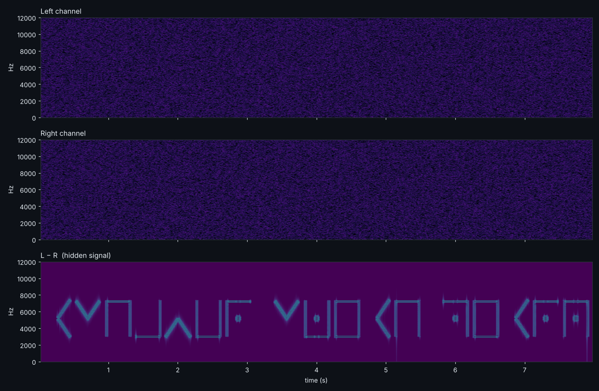
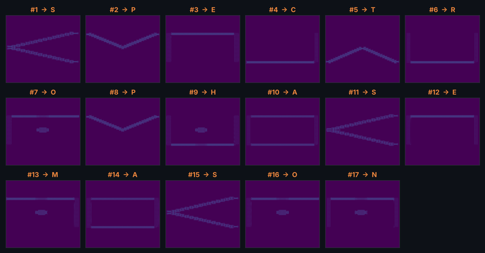
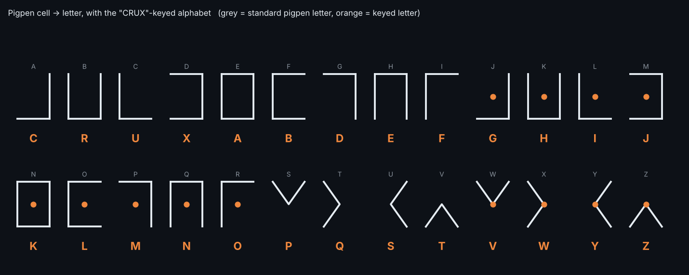

# house-music — Audio Steganography / Forensics (100 pts)

> *tried making some house music, but the foundation was kinda off. lesson learned: CRUX first.*
>
> Download the attached `transmission.wav`.

**Category:** Forensics / Audio steg  **Event:** cruXipher CTF  **Flag format:** `cruXipher{...}`

**Flag:** `cruXipher{spectro_phase_mason}`

---

## TL;DR

1. `transmission.wav` is stereo noise. The left and right channels are identical except for 17 short bursts.
2. **L − R** (the *phase* difference) leaves only those bursts. Their **spectrogram** draws **pigpen cipher** symbols.
3. "CRUX first" means a **keyed pigpen alphabet** (`CRUX` + the rest of the alphabet), which is the "foundation that was off".
4. Decoding gives `SPECTRO PHASE MASON`.

---

## 1. First look

```bash
$ file transmission.wav
RIFF (little-endian) data, WAVE audio, Microsoft PCM, 16 bit, stereo 44100 Hz
```

About 8 s, 352,584 frames, stereo, 16-bit PCM. The standard checks found nothing useful:

| Check | Result |
|---|---|
| `strings` | nothing |
| `binwalk` | false positive (a "JBOOT" signature inside random bytes) |
| `steghide` with `CRUX` | wrong guess, failed |
| LSB planes (L, R, interleaved) | random bytes |
| Spectrogram of the stereo mix | flat noise |

What stood out was the channel relationship:

```python
import wave, numpy as np
w = wave.open("transmission.wav")
a = np.frombuffer(w.readframes(w.getnframes()), "<i2").reshape(-1, 2).astype(int)
L, R = a[:, 0], a[:, 1]
print((L == R).mean())          # 0.301  -> 30% of samples are identical
print(np.nonzero(L - R)[0][0])  # 11682  -> first difference at 0.265 s
```

L and R are the same noise, and they differ only in a few places. That points to a signal hidden in the **difference** between the channels (a phase-style trick). The challenge text hints at this too: "foundation was kinda off" fits channels that are slightly out of line.

## 2. Look at L − R

```python
d = L - R          # equivalent to inverting one channel and summing (phase cancellation)
```

Everything cancels except the hidden signal. It is exactly `0` outside 17 bursts, and it peaks at ±7000. A spectrogram of `d` shows what was hidden:



The mix and each single channel look like plain noise. **L − R** shows drawn symbols: boxes, corners, wedges and dots.

## 3. Recognise the symbols: pigpen

These are the cells of the **pigpen (Freemason's) cipher**: the `#` grid cells (A–I), the same cells with a dot (J–R), the `X` grid wedges (S–V) and the dotted wedges (W–Z).

The glyphs are drawn directly into the spectrogram:

| Stroke | How it is encoded |
|---|---|
| top edge | 7.3 kHz tone |
| bottom edge | 3.0 kHz tone |
| vertical edge (left/right) | broadband click |
| diagonal (wedge) | frequency sweep |
| dot | short 5.2 kHz blob in the middle |

Exact digital silence separates the glyphs: a short gap between letters, and a long gap (~0.34 s) between words. That gives 17 glyphs in 3 words.



## 4. "CRUX first" — the keyed alphabet

Decoding with the standard pigpen table gives gibberish (`USHAVBR…`). That is the "foundation off" part. The hint **CRUX first** says the alphabet starts with `CRUX`: a keyed alphabet where the key is placed first and the remaining letters follow in order.

```
slot : A B C D E F G H I J K L M N O P Q R S T U V W X Y Z   (pigpen cell, standard order)
key  : C R U X A B D E F G H I J K L M N O P Q S T V W Y Z   (CRUX + the rest)
```



Reading the glyphs with this table:

| # | 1 | 2 | 3 | 4 | 5 | 6 | 7 | | 8 | 9 | 10 | 11 | 12 | | 13 | 14 | 15 | 16 | 17 |
|---|---|---|---|---|---|---|---|---|---|---|---|---|---|---|---|---|---|---|---|
| letter | S | P | E | C | T | R | O | ␣ | P | H | A | S | E | ␣ | M | A | S | O | N |

`SPECTRO PHASE MASON`: the three words describe the method. **Spectro**gram, **phase** (L − R) and **mason** (the Freemason pigpen cipher).

Words are joined with `_`, as the format suggests, and the flag is lowercase:

```
cruXipher{spectro_phase_mason}
```

## 5. Solver

[`solve.py`](solve.py) automates all of it: it takes L − R, splits it into glyphs on the exact silences, reads each glyph's edges and dot from the spectrogram, and maps them through the keyed alphabet.

```bash
$ python3 solve.py files/transmission.wav
SPECTRO_PHASE_MASON
cruXipher{spectro_phase_mason}
```

Requires `numpy` only. The figures in this writeup were drawn with `matplotlib`.

## Takeaways

- When the stereo mix looks like noise, always look at **L − R** (or invert one channel and sum) before going deeper into LSB.
- Spectrogram art can be drawn in any shape. Here the "font" is a cipher alphabet, so read the symbols as ciphertext.
- Challenge hints are literal: "foundation" is the pigpen grid, and "CRUX first" is the keyword at the start of the alphabet.
- Two cheap things to try on any steg challenge early: a spectrogram, and a channel difference.

## Files

```
README.md
solve.py
files/transmission.wav
images/01_spectrograms.png
images/02_glyphs.png
images/03_keyed_pigpen.png
```
